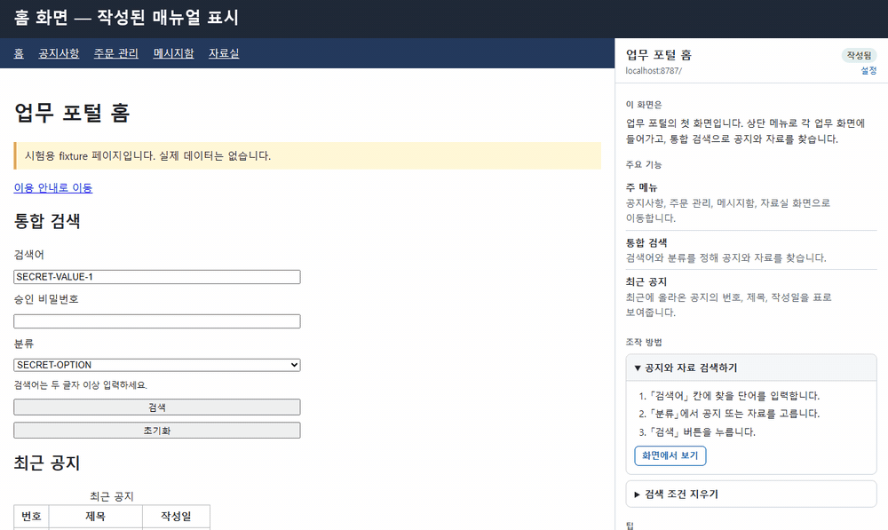
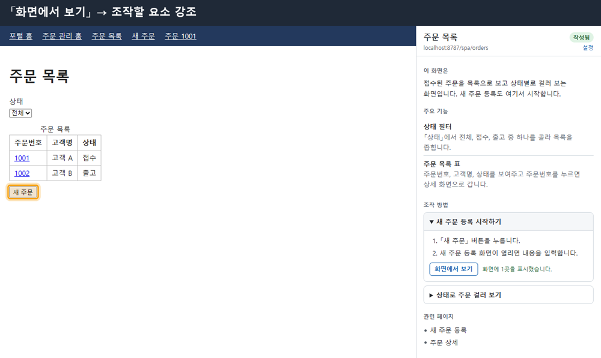
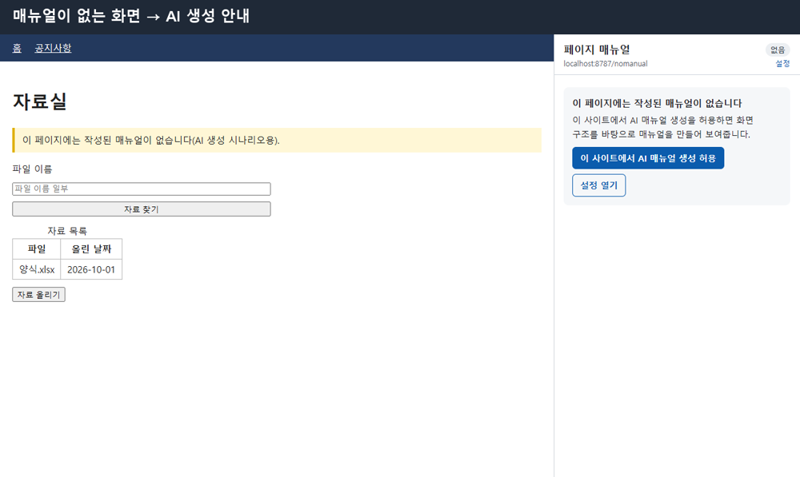

# 페이지 매뉴얼 (Chrome 확장)

업무 시스템을 쓰다가 화면을 옮길 때마다 **그 화면의 역할, 주요 기능, 조작 방법**을 브라우저 사이드 패널에 보여주는 Chrome 확장 프로그램입니다.



> 위 영상은 저장소에 들어 있는 데모 사이트(`extension/tests/fixtures`)에서 실제 확장을 로드해 녹화했습니다. 왼쪽은 웹 페이지, 오른쪽은 확장의 사이드 패널입니다.

## 주요 기능

- **화면이 바뀌면 매뉴얼도 바뀝니다.** 아래 이동을 모두 감지합니다.
  - 일반 링크 이동
  - SPA 화면 전환(`pushState`)
  - 해시 라우팅(`#/inbox`)
  - 탭 전환
- **미리 작성한 매뉴얼을 먼저 보여줍니다.** `extension/manuals/`의 JSON 매뉴얼을 URL 패턴(exact · glob · regex)으로 찾아 보여줍니다.
- **매뉴얼이 없으면 AI가 만듭니다.** 허용한 사이트에서만, 사용자의 Claude API 키로 화면 구조를 분석해 매뉴얼을 만듭니다. 만든 결과는 캐시에 저장해 다시 씁니다.
- **「화면에서 보기」를 누르면 조작할 버튼이나 입력 칸을 페이지 위에 주황색으로 강조합니다.**
- **개인정보를 AI로 보내지 않습니다.**
  - 입력값, 편집 중인 글, 표 본문, URL 쿼리는 아예 수집하지 않습니다.
  - 그 밖의 글자에 섞인 이메일, 전화번호, 주민번호, 카드·계좌번호 형태는 가린 뒤에 보냅니다.

| 조작할 요소 강조 | 매뉴얼이 없는 화면 |
| --- | --- |
|  |  |

## 설치

1. 이 저장소를 내려받습니다.
2. Chrome에서 `chrome://extensions`를 엽니다.
3. 오른쪽 위 **개발자 모드**를 켭니다.
4. **압축 해제된 확장 프로그램 로드**를 누르고 아래 폴더 가운데 하나를 고릅니다.
   - 시험용: `extension/` (데모 매뉴얼 포함)
   - 배포용: `node tools/package-extension.mjs`로 만든 `dist/manual-extension/` (데모 매뉴얼과 개발용 권한 제외)
5. 툴바의 **페이지 매뉴얼** 아이콘을 누르면 사이드 패널이 열립니다.

Chrome 116 이상이 필요합니다.

## 데모 사이트로 시험하기

```bash
node extension/tests/fixtures/serve.mjs
```

브라우저에서 `http://localhost:8787`을 열고 사이드 패널을 켠 뒤 메뉴를 눌러 보세요. 포털 홈, 공지, SPA 주문 관리, 해시 라우팅 메시지함 화면에 데모 매뉴얼이 준비되어 있습니다.

## AI 매뉴얼 생성 설정

1. 사이드 패널의 **설정**을 눌러 옵션 페이지를 엽니다. `chrome://extensions`의 확장 **세부정보 → 확장 프로그램 옵션**으로도 열 수 있습니다.
2. Claude API 키를 입력하고 모델을 고릅니다. 기본값은 `claude-haiku-5-5`입니다.
3. AI 생성을 허용할 사이트를 추가합니다. 매뉴얼이 없는 화면의 패널에서 **이 사이트에서 AI 매뉴얼 생성 허용**을 눌러도 됩니다.

API 키는 이 브라우저의 `chrome.storage.local`에만 저장됩니다. 요청은 확장에서 `api.anthropic.com`으로 직접 보냅니다.

## 매뉴얼 작성

사이트별 매뉴얼은 `extension/manuals/{siteId}.json`에 두고 `extension/manuals/index.json`에 등록합니다.

```json
{
  "id": "approval-inbox",
  "match": { "type": "glob", "pattern": "/approval/*" },
  "title": "결재함",
  "role": "나에게 도착한 결재 문서를 확인하고 승인하거나 반려하는 화면입니다.",
  "features": [{ "name": "결재 문서 검색", "description": "기간과 문서 종류로 찾습니다." }],
  "howTo": [{ "task": "결재 승인하기", "steps": ["문서를 엽니다.", "「승인」을 누릅니다."], "targets": ["#btnApprove"] }],
  "updatedAt": "2026-10-23",
  "source": "authored"
}
```

- 전체 스키마는 [`.claude/skills/page-manual-authoring/references/manual-schema.md`](.claude/skills/page-manual-authoring/references/manual-schema.md)에 있습니다.
- 매뉴얼을 고친 뒤에는 아래 검증기로 확인합니다.

```bash
node .claude/skills/page-manual-authoring/scripts/validate_manuals.mjs extension/manuals
```

## 개발

빌드 도구 없이 순수 ES 모듈로 작성했습니다.

```bash
# 단위·통합 테스트 (Node 22 이상, glob 인자 지원 필요)
node --test "extension/tests/**/*.test.js"

# 정적 검사 (manifest, 메시지 계약, 매뉴얼 JSON, 금지 패턴)
node .claude/skills/extension-qa/scripts/validate_extension.mjs extension

# 배포본 만들기 → dist/manual-extension/
node tools/package-extension.mjs
```

브라우저 테스트(`page-agent.browser.test.js`)는 Playwright를 찾으면 실행하고, 찾지 못하면 건너뜁니다. Playwright 위치는 `PLAYWRIGHT_MODULE` 환경 변수로 지정할 수 있습니다.

```
extension/
├── manifest.json
├── manuals/            # 작성 매뉴얼 (배포 포함)
├── manuals-dev/        # 데모 매뉴얼 (배포 제외)
├── src/
│   ├── background/     # 서비스 워커: 이동 감지, 매뉴얼 조회, AI 생성
│   ├── content/        # page-agent: 화면 구조 추출, 강조 표시
│   ├── sidepanel/      # 사이드 패널 UI
│   ├── options/        # API 키·모델·허용 사이트 설정
│   └── shared/         # 메시지 계약, URL 매칭, 스키마, 개인정보 마스킹
└── tests/
```

## 알려진 한계

- 한글 숫자로 쓴 전화번호("공일공…")는 가리지 못합니다.
- 화면 전체를 `<table>`로 배치한 오래된 시스템에서는 AI 매뉴얼에 쓸 화면 구조가 거의 수집되지 않습니다. 미리 작성한 매뉴얼과 강조 표시에는 영향이 없습니다.
- 프레임셋(`<frameset>`)으로 만든 시스템에서는 화면 이동을 감지하지 못합니다.
